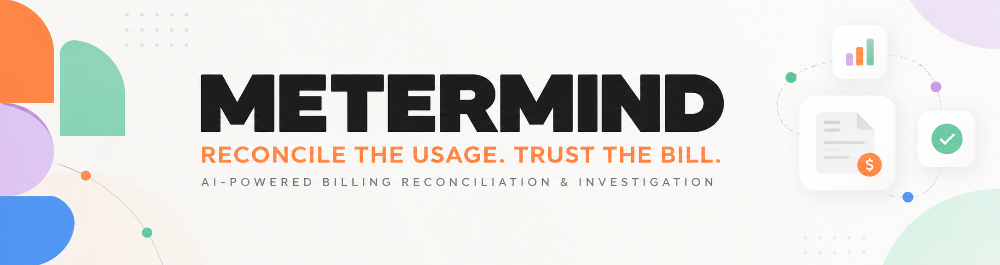
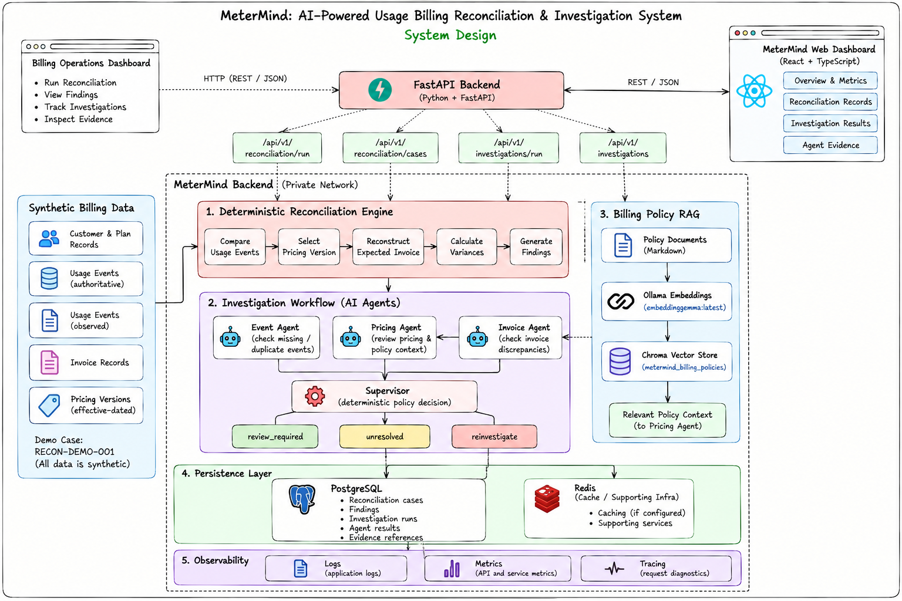
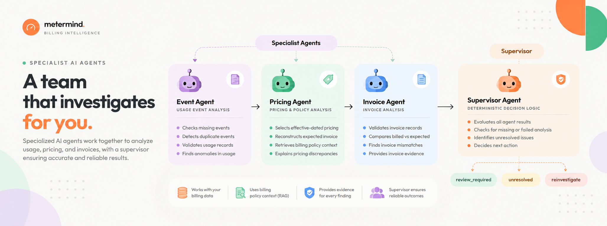
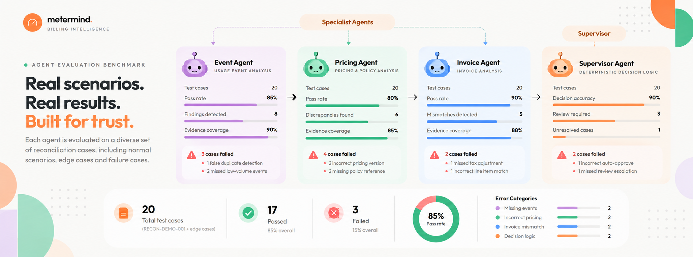

  

# AI-Powered Usage Billing Reconciliation & Multi-Agent Investigation System

AI-powered billing reconciliation platform built with FastAPI, PostgreSQL, LangChain, Ollama, and React. MeterMind compares usage events, pricing plans, and invoices through a deterministic reconciliation engine, then investigates every discrepancy with specialist AI agents and a policy-aware supervisor, with all findings tied to traceable evidence.

## Overview

Usage-based SaaS billing depends on accurate usage events, correct pricing rules, and consistent invoice calculations. Missing events, duplicate records, wrong pricing versions, and invoice mismatches lead to overbilling, underbilling, and slow, manual investigations. MeterMind solves this by building a fully automated pipeline:

1. The **Reconciliation Engine** compares authoritative and observed usage events, selects the effective-dated pricing version, and reconstructs the expected invoice using deterministic business logic.
2. The **Event, Pricing, and Invoice Agents** investigate the findings. The Event Agent examines missing and duplicate usage, the Pricing Agent reviews pricing versions and retrieves billing policies via RAG (Ollama embeddings + Chroma), and the Invoice Agent compares billed amounts with expected results.
3. The **Supervisor** evaluates agent results, failures, and unresolved findings, then makes a deterministic routing decision: `review_required`, `unresolved`, or `reinvestigate`.
4. The **Persistence Layer** stores reconciliation records, findings, investigation runs, structured agent results, and evidence references in PostgreSQL, ready for review in the React dashboard.

The LLM assists with investigation and explanation only. Deterministic calculations remain authoritative, and no AI agent can authorize a financial correction.

---

## System Design

**Billing Data → Reconciliation Engine → Specialist Agents → Supervisor → PostgreSQL → React Dashboard**

---

## Agent Architecture

---

## Agent Evaluation Benchmark

> The benchmark image is a visual representation of an evaluation dashboard. Percentages and counts are illustrative unless independently verified against the actual test suite.

---

## Technology Stack

| Layer | Technology | Purpose |
|---|---|---|
| Backend API | Python, FastAPI | Reconciliation and investigation endpoints |
| Agent Workflow | Specialist agents + deterministic supervisor | Investigation and workflow decisions |
| LLM Integration | LangChain, Ollama | AI-assisted investigation and explanation |
| Local LLM | `gemma4:e2b` | Investigation commentary |
| Embeddings | `embeddinggemma:latest` | Embeddings for billing policy retrieval |
| Vector DB | Chroma | Storage and retrieval of policy embeddings (RAG) |
| Relational DB | PostgreSQL | Persistent storage for cases, findings, and investigations |
| Cache | Redis | Supporting cache and infrastructure |
| Frontend | React, TypeScript, Vite | Landing page and dashboard |
| Styling | Tailwind CSS | Frontend styling |
| Testing | pytest | Backend behavior and workflow policy validation |
| API Docs | FastAPI, Swagger UI | Interactive API exploration |

---

## API Reference

| Method | Endpoint | Purpose |
|---|---|---|
| `GET` | `/api/v1/dashboard/summary` | Dashboard summary information |
| `GET` | `/api/v1/fixture/overview` | Demo fixture information |
| `POST` | `/api/v1/reconciliation/run` | Run deterministic reconciliation |
| `GET` | `/api/v1/reconciliation/cases` | List persisted reconciliation cases |
| `GET` | `/api/v1/reconciliation/cases/{case_id}/findings` | Findings for a case |
| `POST` | `/api/v1/investigations/run` | Run and persist an investigation |
| `GET` | `/api/v1/investigations` | List persisted investigations |
| `GET` | `/api/v1/investigations/{case_id}` | Investigation details |
| `GET` | `/api/v1/investigations/{case_id}/cases` | Grouped investigation cases |

Full request/response examples are available in the
[API Documentation](https://github.com/MGhiremath0281/MeterMind/blob/main/docs/api/API_DOCUMENTATION.md).
Interactive Swagger UI is served at `http://127.0.0.1:8000/docs`.

---

## Roadmap

### 1. Scenario-Based Agent Evaluation
- Expand evaluation with reproducible test fixtures.
- Measure investigation latency and failure rates across representative cases.

### 2. Auditability & Policy Intelligence
- Improve evidence inspection and auditability in the dashboard.
- Add more billing policy documents and retrieval evaluation tests.

### 3. Production Readiness
- Strengthen operational monitoring and deployment automation.
- Integrate authorized billing adjustment workflows with explicit approval controls.

---

---
### Professional Network

  
  &nbsp;&nbsp;&nbsp;&nbsp;
  
  &nbsp;&nbsp;&nbsp;&nbsp;
  
  &nbsp;&nbsp;&nbsp;&nbsp;
  

